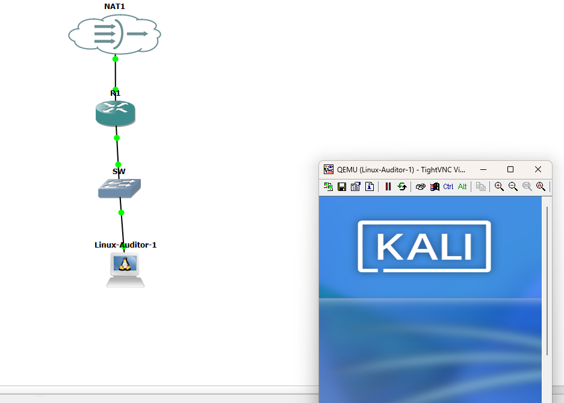
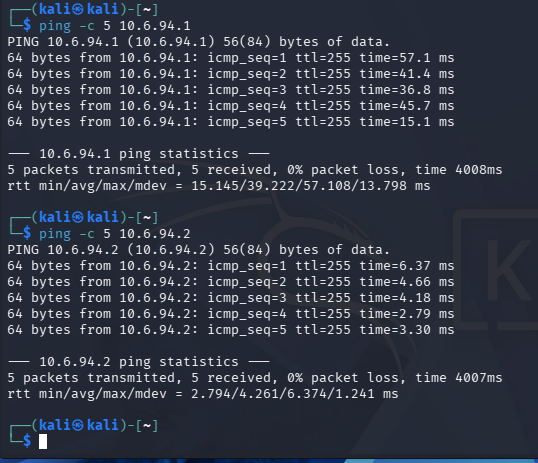
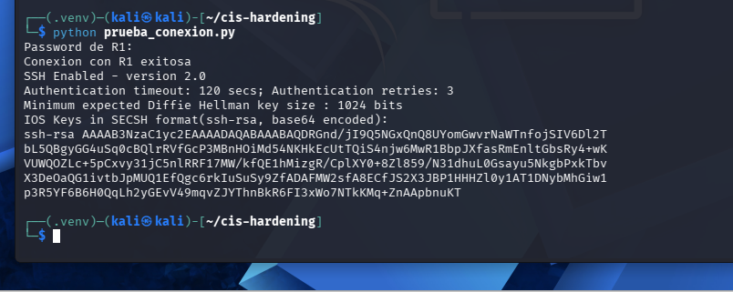
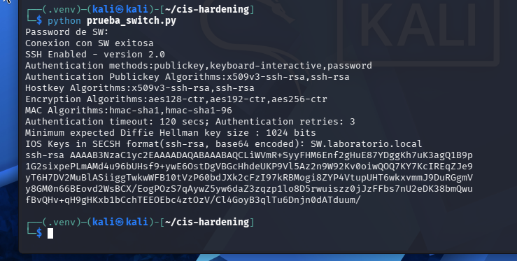
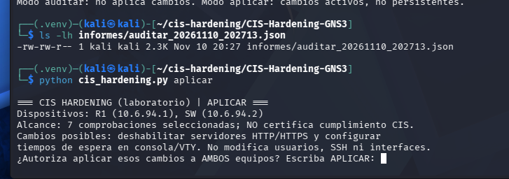
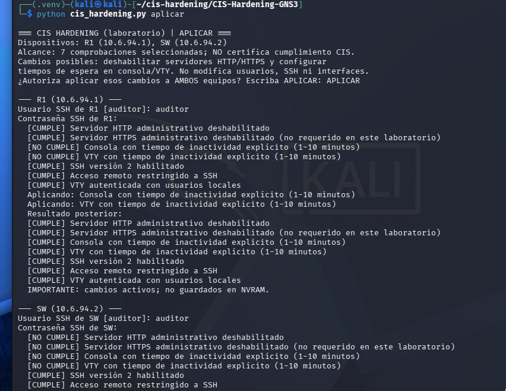
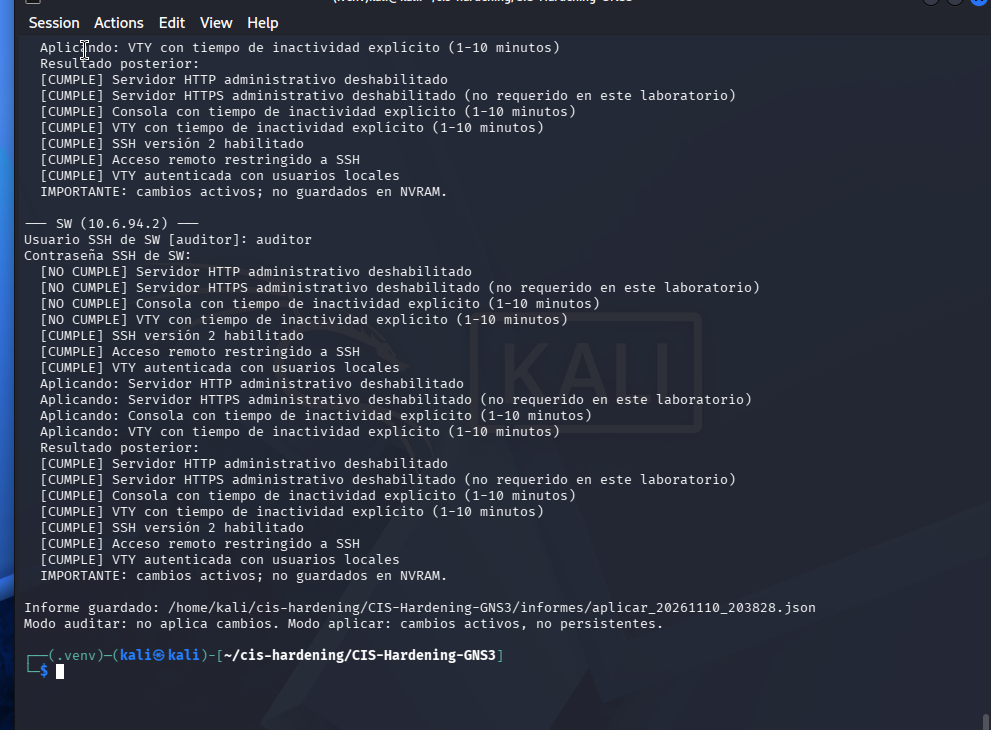
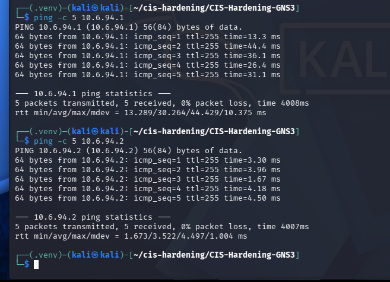
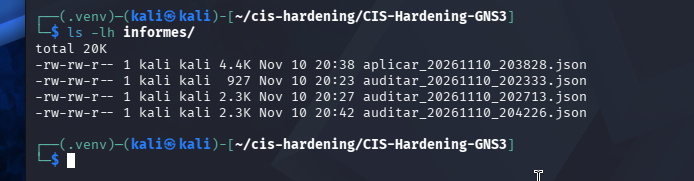

# Evidencias y pruebas realizadas

## 1. Topología y conectividad inicial

## 2. Automatización SSH con Netmiko

## 3. Informe de auditoría inicial

## 4. Aplicación autorizada del hardening

## 5. Auditoría posterior y red funcional

## 6. Informes generados

Los tres informes JSON originales están incorporados en [`docs/informes/`](informes/): auditoría inicial, aplicación de hardening y auditoría posterior. Sus resultados coinciden con las capturas de pantalla.
